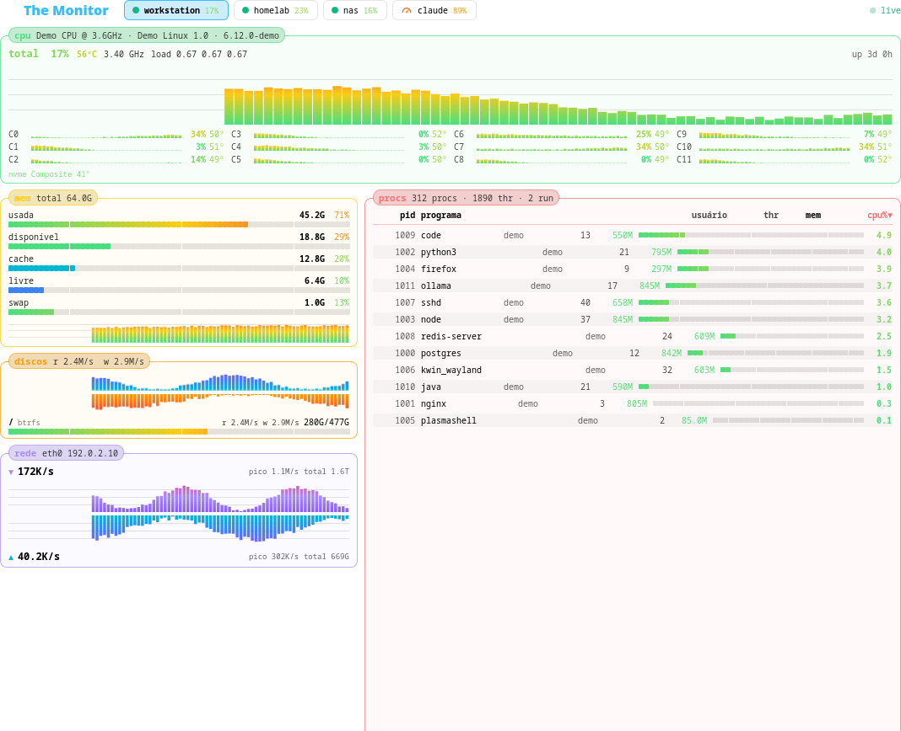
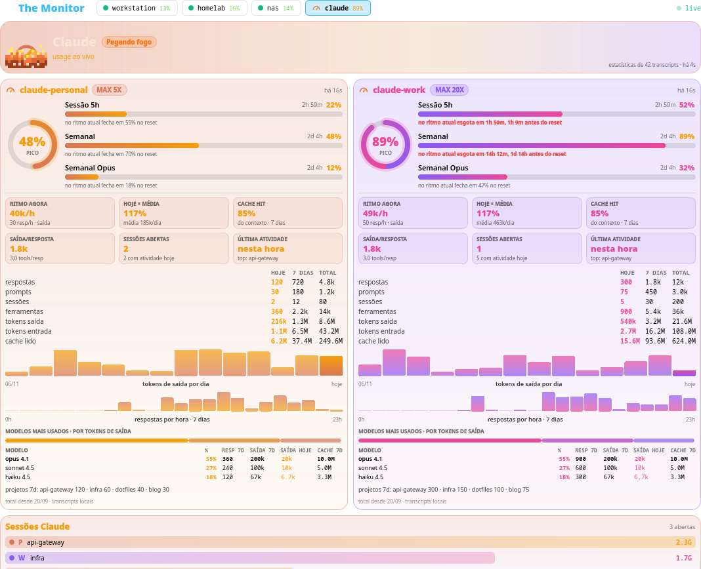

# The Monitor

[](https://github.com/asm444/the-monitor-plasma/actions/workflows/ci.yml)


A KDE Plasma 6 widget that turns your panel into a small observability console: btop-style CPU, memory, disk, network and process views for **any number of machines** (one tab each), plus usage limits, open sessions and activity stats for **any number of Claude accounts**.

It was built with one rule: a monitoring tool sees everything, so it must not become the easiest way into everything. Every channel that crosses a trust boundary has a named attacker, a defence, and a test that fails when the defence is removed ([SECURITY.md](SECURITY.md)).

| Machines | Claude accounts |
|---|---|
|  |  |

*Screenshots taken in demo mode: every number, host and account in it is synthetic.*

## What it does

- **Fleet observability without installing anything on the targets.** The hub pipes a single stdlib-only Python file over `ssh` and reads one JSON line per second. A target needs only `sshd` and `python3`.
- **Live history.** Sparklines per machine for CPU, RAM, swap, disk I/O and network, per-core bars, temperatures, batteries, GPUs and a top-process table with full command lines (secrets removed at the source).
- **Several Claude accounts.** Every `~/.claude` and `~/.claude-<name>` that holds credentials appears automatically: session and weekly limits with reset times, running `claude` sessions and their memory, and per-account stats (messages, tokens, models, projects, two-week history).
- **Health at a glance.** A host turns red when its agent stops answering, and its tab shows the last error.

## Architecture

```
            ~/.config/the-monitor/config.toml
                       │
   ┌───────────────────┴───────────────────┐
   │ hub.py                                 │   one thread per [[dispositivo]]
   │  ├─ local:  python3 agentes/<tipo>.py   │
   │  └─ remote: ssh -- host python3 - < agentes/<tipo>.py
   │        caps: line size, nesting depth, interfaces, stderr drained
   └───────────────┬───────────────────────┘
                   │ ~/.cache/the-monitor/estado.json (0600)
                   ▼
           Plasma widget (QML, PlainText only)
                   ▲
                   │ ~/.cache/the-monitor/claude.json (0600, optionally pushed over ssh)
   ┌───────────────┴───────────────────────┐
   │ coletor.py (machine with the accounts)  │
   │  monitor/claude.py: OAuth usage, sessions, transcript stats
   └────────────────────────────────────────┘
```

No component listens on a network port.

## Install

Requirements: KDE Plasma 6, Python 3.11 or newer (for `tomllib`), `kpackagetool6`, and key-based `ssh` to the remote machines with the host key already in `known_hosts`.

```bash
git clone https://github.com/asm444/the-monitor-plasma.git
cd the-monitor-plasma
./install.sh             # hub + widget
./install.sh --coletor   # also the Claude collector, on the machine that has the accounts
```

Then add the **The Monitor** widget to a panel. QML changes take effect after `systemctl --user restart plasma-plasmashell`.

## Configure

Everything lives in `~/.config/the-monitor/config.toml`; [config.example.toml](config.example.toml) shows every option.

**Add a machine:**

```toml
[[dispositivo]]
nome = "homelab"
destino = "homelab"      # local, an ~/.ssh/config alias, or user@host
```

**Add a Claude account:** run `CLAUDE_CONFIG_DIR=~/.claude-work claude` and log in. It shows up on the next collector cycle.

**Add a device type:** drop a file in `agentes/<tipo>.py` that prints one JSON line per second in the same shape as [`agentes/linux.py`](agentes/linux.py), then set `tipo = "<tipo>"`. [`agentes/demo.py`](agentes/demo.py) is a complete example that fakes a machine.

## Try it with synthetic data

```bash
systemctl --user stop the-monitor.service the-monitor-coletor.service
./demo/run.sh
```

Three synthetic machines and two synthetic Claude accounts feed the widget until you press Ctrl-C.

## Tests

```bash
python3 -m unittest discover -s tests
```

The suite is security-first: each test names the attack it blocks (rich-text injection, secret leakage, ssh option injection, oversized or deeply nested input, file permissions). Each defence was broken on purpose to confirm its test fails.

## Contributing and ideas

Ideas, bug reports and pull requests are very welcome, especially:

- new device types (`agentes/macos.py`, `agentes/windows.py`, routers, containers);
- other AI accounts or usage providers next to Claude;
- an English translation of the widget UI, which is in Portuguese today;
- new attack ideas against the monitor, reported privately as described in [SECURITY.md](SECURITY.md).

Open an [issue](https://github.com/asm444/the-monitor-plasma/issues/new/choose) or start a [discussion](https://github.com/asm444/the-monitor-plasma/discussions). [CONTRIBUTING.md](CONTRIBUTING.md) has the ground rules.

## Notes

- Claude usage comes from the OAuth endpoint the Claude apps use (`api.anthropic.com/api/oauth/usage`). It is undocumented and may change. The token is read from your local credentials file and sent only to that endpoint.
- This project is independent of Anthropic. "Claude" is a trademark of Anthropic.
- The pixel-art status sprites were generated procedurally by the author.

## Resumo em português

The Monitor é um widget do KDE Plasma 6 que mostra, em abas, os recursos de várias máquinas, monitoradas por ssh sem instalar nada nelas, e o uso de várias contas Claude. Para adicionar uma máquina, basta um bloco `[[dispositivo]]` em `~/.config/the-monitor/config.toml`. Para adicionar uma conta, rode `CLAUDE_CONFIG_DIR=~/.claude-<nome> claude` e faça login. A segurança vem documentada em [SECURITY.md](SECURITY.md): cada vetor de ataque tem a defesa e o teste que a prova. Contribuições e ideias são bem-vindas nas issues e nas discussions.

## License

[MIT](LICENSE)
